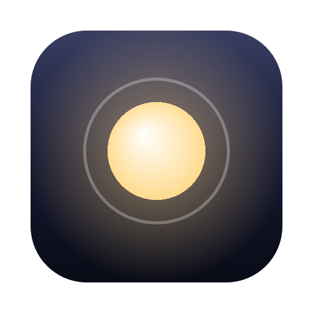
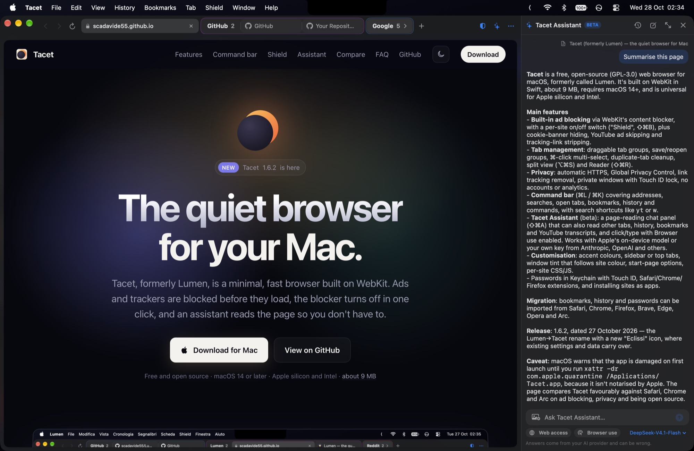
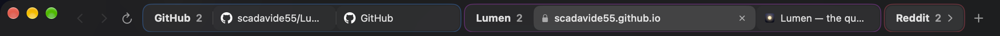

<div align="center">



# Lumen

**The quiet browser for your Mac.**

A minimal, fast and private macOS browser built on WebKit, with a native ad blocker you can turn off in one click.

[](https://github.com/scadavide55/Lumen/releases)
[](https://github.com/scadavide55/Lumen/releases)
[](#requirements)
[](#requirements)
[](Sources)
[](https://webkit.org)
[](https://scadavide55.github.io/Lumen/)

[**Download**](https://github.com/scadavide55/Lumen/releases) · [**Website**](https://scadavide55.github.io/Lumen/) · [**Release notes**](https://github.com/scadavide55/Lumen/releases)





</div>

> [!NOTE]
> **Lumen 1.6 is the first stable release.** Lumen Assistant is still a beta. If something doesn't work, please report it in [Issues](https://github.com/scadavide55/Lumen/issues).

## Features

**Lumen Assistant (beta)**
- An AI assistant in a panel beside the page (⇧⌘A): summaries, answers and explanations about what you're reading
- Bring your own key: Anthropic, OpenAI, OpenRouter, DeepSeek or any OpenAI-compatible server (Ollama, LM Studio)
- **Web access** (on by default): searches the web and reads pages, with the sources listed under each answer
- Opens pages and searches in new tabs, and switches between your tabs when you ask
- **Browser use** (off by default): clicks, types, scrolls and drags on the current page for you. It never fills in passwords or card numbers, and asks before sending, buying or deleting anything
- Chat history on your Mac (not in private windows), a full-window chat view, and a panel you can resize
- Off by default; page content is treated as data, never as instructions

**Lumen Shield**
- Built-in ad and tracker blocking that works offline, toggled with ⇧⌘B
- Optional EasyList and EasyPrivacy filter lists, converted to WebKit rules and refreshed weekly
- Turn protection off for a single site from the shield button
- Hides cookie consent banners and skips YouTube ads
- Blocks third-party cookies

**Privacy**
- Removes tracking parameters (`utm_`, `fbclid`, `gclid` and more) from links
- Upgrades connections to HTTPS and falls back when a site doesn't support it
- Sends Global Privacy Control
- Private windows that forget everything when you close them
- Optionally clears cookies, cache and history when you quit
- HTTPS-only mode, confirmation before downloading apps and scripts, and Touch ID lock for private windows

**Passwords**
- Saves passwords in the macOS Keychain and fills them after Touch ID
- Suggests strong passwords on sign-up pages (optional)
- Imports and exports CSV for Apple Passwords, and works alongside 1Password, KeePassXC and others

**Moving in**
- Imports bookmarks, history and sign-ins from Safari, Chrome, Firefox, Opera, Brave, Edge, Arc and other Chromium browsers
- A guided setup on first launch, in English, Italian or French

**Tabs and windows**
- Tab groups: drag a tab onto another, or let Lumen group tabs from the same site once there are 2, 3 or 5 of them, except sites you exclude
- Save a group and close it, then open it again later with all its tabs; open a new tab inside a group
- Pick several tabs with ⌘-click and ⇧-click to group, move, pin or close them together
- Move tabs or whole groups to another window or profile
- Sort tabs by site, title or last opened, and close duplicate tabs in one click
- Lumen Assistant can group tabs by topic when you ask, such as "Rome trip"
- Sidebar, separate or compact tab layouts
- Install any site as an app with its own window and Dock icon
- Vertical tabs in a resizable sidebar, or tabs along the top
- Pinned tabs, drag to reorder, split view, reopen closed tabs
- Background tabs hibernate to save memory, shown in grey, and wake up where you left them
- Windows and tabs come back when you reopen Lumen

**Getting around**
- Command bar (⌘L / ⌘K) for addresses, searches, open tabs, bookmarks, history and commands
- Search shortcuts, for example `yt lofi` searches YouTube
- Choice of search engine: DuckDuckGo, Google, Bing, Brave, Startpage, Ecosia, Kagi or your own
- Reader mode, find on page, per-site zoom
- Bookmarks with HTML import and export, searchable history, downloads

**Make it yours**
- Light, dark or system appearance and any accent colour
- Sidebar on the left or right, floating page with rounded corners, compact tabs
- Window tint that follows the site's colour
- Start page with clock, greeting, favourites and backgrounds: gradients, animated gradients, your own photo or a short video
- Custom CSS per site

## Keyboard shortcuts

| Shortcut | Action |
| --- | --- |
| ⌘T / ⌘W | New tab / close tab |
| ⇧⌘T | Reopen closed tab |
| ⌘N / ⇧⌘N | New window / new private window |
| ⌘L or ⌘K | Command bar |
| ⌘S | Show or hide the sidebar |
| ⌃Tab / ⌃⇧Tab | Next / previous tab |
| ⌘1 … ⌘9 | Go to tab |
| ⌘[ / ⌘] | Back / forward |
| ⌘F, ⌘G | Find on page, find next |
| ⇧⌘R | Reader |
| ⌥⌘S | Split view |
| ⌘D | Bookmark the page |
| ⌘Y | History |
| ⇧⌘B | Turn the ad blocker on or off |

## Requirements

- macOS 14 Sonoma or later
- Apple silicon or Intel
- Xcode command line tools (to build from source)

## Build

```sh
./build.sh
open Lumen.app
```

`tools/test.sh` runs the logic tests (addresses, link cleaning, password sites, CSV, filter lists, history database, and WebKit compiling Shield's rules). `build.sh` compiles everything in `Sources` for Apple silicon and Intel, assembles a universal `Lumen.app` and signs it ad hoc. `tools/make-dmg.sh` then packages it as a disk image. Translations live in `tools/translations.py`; run it to regenerate the `.lproj` files. To regenerate the icon, run `swift tools/make-icon.swift Resources/Lumen.iconset` followed by `iconutil -c icns Resources/Lumen.iconset -o Resources/Lumen.icns`.

## Installing a downloaded build

Open the `.dmg` and drag Lumen to Applications. Release builds are not notarized yet, so on recent versions of macOS the first launch says Lumen "is damaged and can't be opened". The download is fine: macOS blocks apps from the internet that Apple hasn't notarized. Run this once in Terminal, then open Lumen normally:

```bash
xattr -dr com.apple.quarantine /Applications/Lumen.app
```

After that, Lumen tells you about new versions and can install them for you.

## License

Lumen is free software, released under the [GNU General Public License v3.0](LICENSE).
